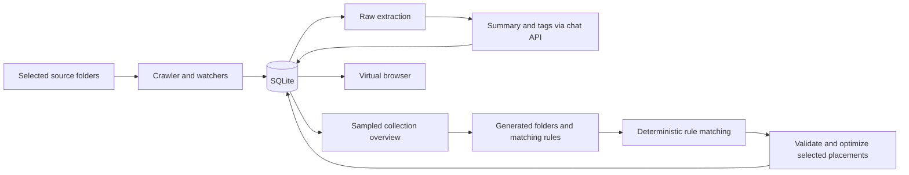

# Fily: audit and small-alpha plan

Audit date: 5 November 2026. Baseline: `eb8e6e2`, local branch `Test`.

Target agreed in this chat: a polished experience for a few people running the
project from Git. Signing, notarization, public distribution, and automatic
updates are deferred. The findings below describe the original baseline; the
implementation status section records subsequent work.

## Implementation status — first milestone

Implemented on branch `codex/alpha-foundation`:

- One npm workspace install and lockfile, including desktop. Node 22 is declared
  in `.nvmrc` and package engines. `npm ci` rebuilds SQLite for the installed
  Electron version and verifies it with `npm run doctor`.
- Tests use Electron's headless Node runtime, sharing the app's native ABI.
  Database integration failures now fail the suite instead of silently skipping.
- CI is configured for Linux and macOS, including the desktop build and a macOS
  desktop smoke test using an isolated profile.
- Watched revision replacement is transactional, removes outdated analysis and
  placements, preserves unchanged analysis, and keeps overlapping-source ownership.
  Revision-based IDs remain in place; stable logical identity is future work.
- Large cleanup advances by row ID, avoiding skipped rows after deletions.
  Incomplete scans retain existing indexed items and analysis, and successful
  rescans restore files previously marked missing.
- Large-tree loading aggregates every descendant into top-level folders, with
  accurate counts and visible root-level files. The IPC handler uses the same
  loader as the integration tests.
- Development startup waits for its own Vite server to bind before starting
  Electron and closes the server when the app exits.
- README setup and privacy claims have been corrected.

Local validation: clean dependency installation, SQLite doctor, core/UI/desktop
builds, 30 passing tests with zero skips, and an isolated desktop smoke test that
renders the built UI and exercises preload/IPC against a synthetic library.
Published as [PR #3](https://github.com/paulkoslo/Fily/pull/3), targeting `main`.
GitHub-hosted Linux and macOS checks passed. Merged on 6 November 2026.

This is the development/correctness milestone. Dependency security upgrades,
renderer/IPC hardening, resumable AI jobs, extraction/OCR, Jev evaluation, and the
browser redesign remain outstanding before inviting alpha testers.

## Implementation status — desktop security boundary

Implemented on `codex/desktop-security`, based on the foundation branch:

- Sandboxed renderer and bundled contracts-only preload; only Electron remains an
  external preload import. A build check rejects accidental Node/native imports.
- Every IPC handler verifies the expected window, main frame, and exact renderer
  URL. Navigation, new windows, embedded webviews and permission requests are restricted.
- File opens accept indexed IDs, and folder reveals accept source-relative paths.
  Canonical path checks reject traversal and escaping symlinks. Extraction, crawling,
  and watcher indexing also check source boundaries.
- Adding a source requires a short-lived, single-use grant from the native picker.
- Database source-prefix queries treat case and wildcard characters literally.
- Production CSP disallows inline scripts. Development uses a per-server nonce
  for Vite's bootstrap and permits only its local hot-reload connection.
- Both built and development desktop smoke tests exercise the sandbox, preload,
  valid IPC, hostile window IPC, forged source additions, traversal, CSP and popups.

Published as [PR #4](https://github.com/paulkoslo/Fily/pull/4), targeting `main`
and dependent on #3. Merged on 6 November 2026. Validation: 33 core tests and four desktop tests pass, with
zero skips; both desktop smoke modes and GitHub's Linux/macOS checks pass.

## Implementation status — encrypted credentials

Implemented on `codex/credential-storage`, based on the security branch:

- Settings keys use Electron safeStorage (macOS Keychain), private atomic writes
  and a versioned schema. An unavailable/locked backend and Linux `basic_text`
  cannot silently fall back to plaintext.
- Legacy user-data `.env` keys are removed only after encrypted persistence and
  decryption verification. Existing encrypted values take precedence over stale
  legacy copies. Unrelated settings remain, and explicit project `.env` files
  are never modified.
- Startup waits for Electron readiness before accessing encryption. Storage
  failures are reported through the existing Settings/key-prompt error surface.
- Provider deletion and model changes preserve other credentials. Key validation
  bounds input size and rejects control characters/config injection.
- Tests use an injected test cipher and temporary profiles, covering restart,
  migration, key precedence, locked storage, corruption, encryption/decryption
  failures, failed atomic writes, deletion and settings preservation. They never
  access the user's real credentials or Keychain.

Validation: 33 core tests and 15 desktop tests pass (zero skips), and both built
and development desktop smoke tests pass with isolated profiles.

Published as [PR #5](https://github.com/paulkoslo/Fily/pull/5), merged on
6 November 2026. Main CI passed after all three merges.

## Implementation status — dependency security

Implemented on `codex/dependency-security`:

- Upgrade Electron 27 to 45, rebuild/native tooling, SQLite, Vite, OpenAI SDK,
  Zod and document parsers. Node 22.12+ is required.
- SheetJS uses its official versioned 0.20.3 distribution, pinned by lockfile
  integrity; the old npm registry release is no longer used.
- PDF extraction uses the maintained parser API, disables PDF evaluation,
  releases parser resources, and leaves global stdout/stderr untouched.
  Textless PDFs explicitly report that OCR is needed and no longer store a
  base64 copy of the original document in metadata. OCR is still outstanding.
- Critical/high dependency advisories are resolved. Moderate minimatch advisories
  remain in electron-builder tooling; upstream fixes are still needed. Avoid
  processing untrusted source checkouts with packaging tools. Cross-major glob
  overrides were rejected because they produced incompatible dependency trees.
- Extraction deadlines are cleared on success and failure. An isolated process
  regression test checks that completed work does not retain a 60-second timer.
- Development smoke tests select a temporary port so normal app sessions can
  keep running. Provider SDK regression tests use synthetic responses only.

Validation: clean `npm ci`, a valid dependency tree, 41 core and 15 desktop
passing tests, both desktop smoke modes, and unsigned arm64 packaging pass.
`npm audit` reports six moderate tooling entries, zero high/critical entries;
CI now rejects high/critical advisories. Tests make no paid API calls.

Published as [PR #6](https://github.com/paulkoslo/Fily/pull/6), targeting main
and left unmerged. Linux/macOS checks passed.

## Implementation status — library migration recovery

Implemented on `codex/migration-recovery`, stacked on #6:

- Existing libraries receive a private, integrity-checked `VACUUM INTO` snapshot
  before pending schema changes. The backup includes committed WAL pages, is
  fsynced before migrations, and stays beside the library for manual recovery.
- All pending migrations and version records run in one immediate transaction.
  Failure rolls back schema and data together; foreign keys are checked before
  commit. An unavailable backup directory prevents migration entirely.
- Future/unknown schema versions are refused. Legacy ALTER operations check
  column existence instead of swallowing unrelated SQLite errors.
- Failed initialization closes its database handle, and startup errors appear in
  a native dialog. README documents the backup location and manual restore.
- Synthetic tests cover new/current libraries, WAL data, restrictive permissions,
  verified restore and re-upgrade, rollback, failed/symlinked backup locations,
  unversioned databases, incompatible versions and the real v5-to-v6 upgrade.

Validation: 48 core and 15 desktop tests pass, with zero skips; built and
development desktop smoke tests pass using isolated profiles.

Recoverable AI processing, extraction coverage, model evaluation and the browser
redesign remain outstanding before inviting testers.

## Product direction

Fily should help someone find and understand a messy document collection through
virtual categories, without changing the originals. The useful promise is:
"Find the right file quickly, understand why it belongs here, and correct it
when needed."

Success requires good extraction, reliable processing, useful categories, and
honest uncertainty. A cheaper model improves economics, but cannot recover pages
that were never extracted or fix stale database records.

Keep the existing Electron, React, TypeScript, SQLite, and provider abstraction.
Improve them in measured steps. Start the alpha with documents and images;
show explicit support and failure states for other formats. Audio/video can
remain optional until its separate transcription dependencies are reliable.

## What exists today

The repository is more developed than the older architecture overview suggests:

- A working OpenRouter chat integration, with OpenAI as an alternative.
- Shared Zod IPC contracts and a typed preload bridge.
- SQLite migrations, foreign keys, WAL, and transactional batch writes.
- A source crawler, filesystem watchers, extraction, summaries/tags, taxonomy
  generation, validation, optimization, and virtual browsing.
- A React UI with source navigation, search, three layouts, settings, and progress.
- Git branches, previous pull requests, a Linux GitHub Actions workflow, and
  deterministic tests. CI currently omits the desktop build and launch.

The architecture overview is a vision document, not evidence that all its safety
and performance claims are implemented. The README also overstates privacy,
scanned-PDF handling, and the completeness of document analysis.

### Actual processing flow



The planner generally classifies through generated rules over summaries, tags,
paths, and names. It does not deeply read every original document to choose every
subcategory.

## Verification performed

| Check | Observed result |
| --- | --- |
| `npm run ci:check` | UI/core build passed; 17 tests passed; 5 database integration tests skipped |
| `npm run build:desktop` | Passed |
| Temporary database under local Node | Failed with native ABI mismatch: installed binding ABI 118, Node requires 115 |
| Core suite through Electron's headless Node runtime | All 22 tests passed, including all 5 SQLite integration tests; no skips |
| Actual watcher and SQLite in a temporary library | Two revisions at one path leave two live file records |
| Actual large-tree database methods and builder | 10,001 nested placements report 10,001 files but zero visible folders |
| Actual cleanup database method on 20,000 temporary records | Of 19,000 stale records, only 10,000 removed; 9,000 skipped |
| Root `npm audit --json` | 26 affected dependency entries: 1 critical, 21 high, 2 moderate, 2 low |
| Desktop `npm audit --json` | 26 affected dependency entries: 1 critical, 21 high, 3 moderate, 1 low |

Audit counts overlap across the two dependency trees and must not be added.
They are advisory matches, not proof that every issue is exploitable in Fily.
The critical root entry is transitive `tar` in the build tooling. Runtime document
parsers also need attention: the installed `xlsx` package has high-severity
advisories and npm reports no automatic fix.

No paid AI calls were made. The normal UI was not launched against the user's
library. UI observations come from source inspection and the repository's
promotional screenshot, not a complete live interaction/accessibility audit.
No existing user database, credentials, or original documents were changed.

The successful alternate test command was:

```bash
ELECTRON_RUN_AS_NODE=1 \
  ./apps/desktop/node_modules/electron/dist/Electron.app/Contents/MacOS/Electron \
  --test packages/core/tests/*.test.js
```

This confirms the existing tests can pass with the matching installed runtime;
it does not replace a reproducible host-Node/Electron build strategy.

## Findings and priorities

### 1. Data identity and reconciliation — highest priority

**Editing a file can create duplicate live entries.**
`computeFileId` hashes path, size, and modification time. The watcher inserts the
new identity through `ON CONFLICT(file_id)` without retiring the old identity.
This can leave duplicate search results and outdated analysis/placements until
a later reconciliation scan.

Evidence: `packages/core/src/indexer/crawler.ts:50`,
`packages/core/src/indexer/watcher-manager.ts:129`,
`packages/core/src/db/index.ts:832`.

Separate logical file identity from its current content revision. For the alpha,
a persisted identity for a canonical path is sufficient; rename tracking can
initially mean remove-and-add. A changed revision must invalidate analysis and
placements atomically. Handle overlapping sources without duplicating ownership.

**Large cleanup skips stale records.**
`deleteFilesNotInSetOptimized` advances an OFFSET while deleting from the result
set. The next page shifts underneath it. Use stable keyset iteration or a scan
generation marker. An incomplete scan must not remove records from unreadable
subtrees. These are index deletions, not deletions of original files.

Evidence: `packages/core/src/db/index.ts:1719`, crawler cleanup path.

### 2. Large-library browsing and search — highest priority

**Categories disappear above 10,000 placements.** The large-tree path selects
only `/Folder/file` placements. A category containing exclusively deeper paths,
such as `/Work/Invoices/2026/file.pdf`, has no representative row. Aggregate all
visible placements by their first folder segment, with accurate descendant counts.

Evidence: `apps/desktop/src/main/ipc/virtual-tree-handlers.ts:63`,
`packages/core/src/db/index.ts:2248`.

**File pagination is applied after loading all matching rows.**
`getFilesBySource` calls SQL `.all()`, normalizes and filters in JavaScript, then
slices. A 200-row UI page still reads a potentially large subtree. Move immediate
parent filtering, deterministic ordering, and pagination into SQL.

Evidence: `packages/core/src/db/index.ts:862`.

**Search is narrower and less reliable than advertised.** Smart search checks
name, summary, and tags, not extracted body text. It selects recent candidates
before ranking, which can exclude an older exact filename match. Add local FTS5
for body text and relevance ranking, with explicit literal-query handling and
source scope. Semantic retrieval can follow once lexical search is dependable.

Evidence: `packages/core/src/db/index.ts:953`.

### 3. Processing reliability and memory — highest priority

**Image loading is eager despite the comments.**
`ExtractionOrchestrator.processBatch` reads every image in a collection-wide
`Promise.all` before the agent batches them. Image buffers remain referenced until
the whole call finishes. Load, resize, encode, and release images inside bounded
batch execution, with a total in-flight byte budget.

Evidence: `packages/core/src/agents/extraction-orchestrator.ts:319`.

**The worker pool is a promise concurrency limiter, not background CPU workers.**
Synchronous crawling, synchronous database operations, and document parsing still
run in the Electron main process. More API concurrency cannot solve main-process
blocking. Isolate crawling/parsing behind a background worker or utility process;
choose a clear database owner and communicate with bounded messages.

**Timeouts do not cancel requests.** `Promise.race` rejects while the underlying
call may continue and incur cost. Batch timeouts begin when queued, so a busy
queue can time out work before it starts. Timer cleanup is also missing in the
API helper. Use execution-time deadlines, AbortSignal, bounded retries/backoff,
and explicit cancellation of queued work. Shutdown must settle queued promises.

Evidence: `packages/core/src/agents/api-call-helper.ts:38`,
`packages/core/src/agents/summary-tag-agent/index.ts`,
`packages/core/src/agents/worker-pool.ts`.

**Failures can masquerade as successful analysis.** API and parser failures
produce heuristic summaries/tags; ContentService saves these with no error.
Freshness selection then treats the file as processed. Separate extraction and
analysis status, preserve failure/retry information and provenance, and show
partial completion accurately.

Evidence: `packages/core/src/agents/summary-tag-agent/batch-processor.ts`,
`packages/core/src/extractors/content-service.ts:230`,
`packages/core/src/db/index.ts:2441`.

The UI currently coordinates the pipeline using React flags, callbacks, progress
messages, and waits. Move run ownership into a backend job service with run IDs,
stage results, persisted checkpoints, and protection against overlapping jobs.
The renderer should display backend state rather than determine completion.

### 4. Extraction and classification quality — next priority

**Most document analysis sees an opening excerpt.** Extractors truncate text to
1,000 words, and batched analysis truncates again to 500. Summaries are restricted
to 200 characters. A long report's later sections cannot influence categorization.
Preserve extracted text under explicit resource limits, create page/section
chunks, and select evidence across the document. Track pages/sections processed
and show when analysis is partial.

Evidence: `packages/core/src/extractors/extractor-utils.ts:8`,
`packages/core/src/planner/constants.ts:22`,
`packages/core/src/agents/summary-tag-agent/prompt-builders.ts:163`.

**Scanned PDFs lack a working OCR batch route.** PDF extraction marks scans and
stores base64 bytes in metadata, but grouping treats them as text and the batch
prompt says there is no text; it strips the PDF bytes. Render pages and run a
deliberate OCR pipeline, preferably locally, with bounded page/image budgets.
Avoid retaining large binary payloads in metadata.

**Audio does not work with only the OpenRouter key.** The extractor separately
requires an OpenAI key, assumes English, and sends the audio/video to transcription.
Label the capability accurately and handle missing dependencies as unsupported,
not an unexplained generic failure.

**Tags and confidence lack a quality contract.** Prompts force 15–25 tags and
several path-derived tags; this risks reinforcing the original disorganization.
Confidence is largely a rule-priority heuristic, not a measured probability of
correctness. Use a concise controlled tag vocabulary plus useful entities, keep
evidence/provenance, and calibrate acceptance thresholds on labeled examples.
Validate external model outputs with schemas and ID/membership checks.

### 5. Security and privacy — required before inviting testers

- The README says files and metadata never leave the machine. In reality, text
  excerpts, file names/paths, images, and optional audio are sent to providers.
  Explain this before cloud analysis, allow source/file exclusions, minimize
  absolute paths, and distinguish local indexing from cloud analysis.
- Renderer isolation and disabled Node integration are good foundations, but
  `sandbox: false` is explicit. IPC handlers do not verify their sender. Navigation
  and new windows are not restricted, and CSP permits inline scripts. Bundle a
  minimal preload using contracts-only imports so sandboxing can be enabled;
  enforce sender, navigation, permission, and CSP policies. This follows
  [Electron's security guidance](https://www.electronjs.org/docs/latest/tutorial/security).
- `openFile` accepts an arbitrary renderer-supplied path after existence/type
  checks. Resolve an indexed file ID in main, check source authorization and
  canonical path containment, and apply the same policy to reveal/extract/watch
  actions. Test symlink escapes and source removal races.
- API keys are plaintext in an owner-readable `.env` (`0600`), not encrypted at
  rest. Use macOS Keychain or Electron OS-backed secret storage; migrate existing
  keys deliberately and keep full keys out of the renderer and diagnostics.
- Upgrade Electron, parser dependencies, and tooling in controlled PRs. Triage
  production versus development exposure. Do not blindly apply npm's suggested
  forced fixes, some of which propose unsuitable versions.
- Migration execution has no encompassing transaction or automatic backup. Add
  consistent SQLite backups, transactional version changes, and restore tests
  before changing identity or the schema. Never copy only the main SQLite file
  while ignoring a live WAL.
- Treat document text as untrusted evidence. It must not override classification
  instructions or gain tools, filesystem actions, or network permissions. Enforce
  output schemas, folder membership, and source boundaries in application code.

## Where Jev fits

Verified against official OpenRouter documentation on 5 November 2026:

- The existing OpenRouter credential can authenticate Jev; no second provider
  account is needed. This confirms integration feasibility, not that a valid key
  is configured on this machine.
- Jev returns typed choices, yes/no judgments, or scores with probabilities. It
  does not generate prose, summaries, folder names, or explanations.
- Use a separate decision client for `POST /api/alpha/decisions` (or the supported
  System One SDK surface). Adding its ID to the existing chat dropdown is
  insufficient. See the [Jev API guide](https://openrouter.ai/docs/guides/community/jev).
- `typesafe/jev-1.14` currently lists $0.042 per million input tokens and free
  output. Illustratively, 10,000 documents at 2,000 billed input tokens each cost
  $0.84 for one classification pass. This excludes repeated taxonomy/questions,
  additional hierarchy passes, OCR, summaries, retries, and other service fees.
  See [model pricing](https://openrouter.ai/typesafe/jev-1.14).

Proposed routing:

| Task | Proposed engine | Why |
| --- | --- | --- |
| Parse text, dates, filenames and known formats | Local deterministic code | Fast and inexpensive |
| OCR scans | Local OCR first; explicit cloud fallback | Provides evidence the classifier needs |
| Propose category names and descriptions | Generative model, infrequently | Needs language generation |
| Classify a file among known child categories | Jev decision client | Narrow, typed decision |
| Choose relevant tags from a vocabulary | Jev decisions | Controlled labels |
| Produce a readable summary or extract open-ended entities | Generative/structured extraction model when needed | Beyond fixed choices |
| Resolve uncertain or novel documents | Stronger model or user review | Avoid forced confident errors |

Generate and approve a small initial taxonomy from representative documents.
Persist category IDs/descriptions and its version. Classify each document with
compact, relevant evidence, then descend to child categories only when justified.
Include "none of these" and "insufficient evidence" outcomes. Do not rebuild
the whole taxonomy every time a file arrives.

Store decisions, model and prompt versions, evidence references, cost, latency,
and confidence. Cache by content revision plus the versions of extraction,
taxonomy, and analysis. Manual overrides must survive reprocessing.

Do not assume a model's returned confidence is calibrated for personal files.
Compare Jev against the current approach on the same labeled corpus. Large
advertised context windows are not a reason to send whole libraries; validate
the provider's practical input limits and accuracy for the chosen request shape.

Cloud retention controls can be offered where endpoints support them, with a
clear failure if an eligible provider is unavailable. They do not mean data
stays on the device. See [OpenRouter retention controls](https://openrouter.ai/docs/guides/features/zdr).

## Small-alpha experience

One primary flow: choose folder → see supported files and cloud/cost settings →
analyze → browse → correct uncertain results.

- A restrained macOS-style browser: source/category sidebar, file list or columns,
  and a persistent preview/inspector. Start by making one browsing layout excellent.
- An inspector with preview, summary, original location, assigned categories,
  supporting excerpts, and edit/correct controls.
- A "Needs review" collection with alternatives and useful uncertainty states,
  rather than displaying an uncalibrated percentage as certainty.
- A compact background activity panel showing processed/failed/skipped counts,
  spend, cancel, and retry. Browsing and searching remain available during work.
- Keyboard navigation, Return to open, Space preview where supported, Command-F
  search, focus-visible controls, accessible dialogs, and meaningful empty states.
- Preview a proposed organization; apply it atomically and retain a previous
  version for undo. Acknowledge original-file preservation throughout the flow.
- Keep detailed pipeline controls in advanced settings. Fix stale search/content
  responses and capture source/run IDs when asynchronous work starts.

## Implementation sequence

Each row should be one or a few reviewable PRs. Estimates are deliberately omitted
until setup and migration complexity are measured.

| Order | Deliverable | Acceptance gate |
| --- | --- | --- |
| 1 | Reproducible setup and meaningful CI | Fresh Git checkout installs/runs on the documented macOS setup; desktop builds in CI; required DB tests execute rather than skip |
| 2 | Data correctness fixes | Watcher edits leave one current record; large cleanup removes all stale entries; deeply nested folders appear on both sides of the 10k threshold; overlapping-source regression tests pass |
| 3 | Security and privacy baseline | Source-scoped file operations, verified IPC senders, isolated renderer/preload, secure key storage, accurate cloud disclosure, dependency triage, migration backup/restore checks |
| 4 | Resumable processing service | Persisted job/stage state, bounded memory, correct cancellation and retries; failed AI work remains visibly retryable after restart |
| 5 | Extraction and evaluation corpus | Text preservation/chunks, working scan OCR, format support table, 150–300 consented or synthetic labeled documents, held-out evaluation split |
| 6 | Jev experiment and stable taxonomy | Separate validated decision client; measured accuracy/cost/latency comparison; uncertain/novel files route to review; model choice based on results |
| 7 | Focused browser redesign | Consistent primary flow, inspector, keyboard access, review/correction, undo and reliable search under background load |
| 8 | Invite a few testers | Clean setup rehearsed, small sample library, privacy-safe diagnostics, known limitations and feedback process documented |

Orders 2–3 are prerequisites for inviting testers. Extraction/evaluation design
can begin while reliability work proceeds. Jev should first be exercised on
synthetic fixtures through an explicit, capped integration test.

### Engineering workflow

- Verify the canonical `main` baseline and divergence from `Test` before merging
  work; preserve history. Develop on focused `codex/...` branches with PR review.
- Pin a supported Node version and npm/toolchain, document native module handling,
  consolidate duplicate rebuild tools, and decide a single reproducible workspace
  installation strategy including desktop.
- Use Electron's headless runtime for core tests and the same SQLite binding as
  the app, so host-Node ABI differences cannot silently disable integrations.
- CI should run clean install, formatting/lint/type checks, core and desktop
  builds, required SQLite integrations, and an isolated macOS Electron smoke test.
  Never load a tester's actual library or credentials in tests.
- Add regression tests for observed bugs and failure-oriented integration tests:
  malformed model output, 401/429, offline, cancellation, crash/restart, permission
  denied, corrupt documents, symlinks, duplicate names and overlapping sources.
- Keep live-model evaluations separate, manual and cost-capped. CI uses fakes.
- Add dependency update automation and review advisory reachability. Protect the
  default branch once the checks are dependable; remote settings were not audited.
- Redacted diagnostics should include versions, stage durations, counts, resource
  peaks and error codes. Raw paths, document text and secrets are excluded by default.

### Proposed measurable alpha gates

These are targets to validate, not existing performance claims:

- Reorganizing unchanged files makes no additional analysis calls.
- Editing a file produces one current entry and invalidates outdated results.
- At 1k/10k/50k indexed files, folder/file totals remain correct; specifically test
  10,000 versus 10,001 and nested-only categories.
- Folder navigation and local search p95 below 250 ms on a recorded reference Mac
  after indexing, including while background work is active.
- Mixed image/document processing stays under an agreed measured memory ceiling
  (initial candidate: 1 GB total app RSS on the reference corpus), without growth
  proportional to the total image bytes in the library.
- Cancel stops new scheduling immediately and aborts active requests best-effort;
  interrupted work resumes without paying again for persisted successful stages.
- On the held-out corpus, accepted automatic placements target at least 95%
  precision; separately report coverage, review rate, per-category errors and
  extraction coverage. Raising precision by sending everything to review fails
  the product goal, so report both precision and coverage.
- Display actual cost per 1,000 files, effective full-pipeline latency, cache-hit
  rate, unsupported/failed counts and OCR coverage. Agree on a budget after the
  first measurement; do not promise all-in pricing from classification pricing.
- A new tester can follow the README and reach their first useful organized
  folder without manual native-module debugging.

## First concrete milestone — implemented

The development baseline and three reproduced data/tree bugs now have fixes and
real SQLite regression tests (see implementation status). That makes the next AI experiment
meaningful: we can then measure whether better extraction and Jev actually help
people find files, with a stable app underneath them.
